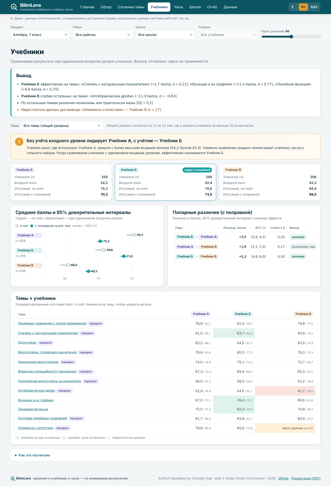

# BilimLens — аналитика учебников и учебных часов

**🔗 Живой сайт (MVP): https://kylyshbay.github.io/bilimlens/**
**📊 Презентация (PDF): [presentation/presentation.pdf](https://github.com/Kylyshbay/bilimlens/blob/main/presentation/presentation.pdf)** · HTML-слайды: [presentation/index.html](presentation/index.html)
**Команда:** Кылышбай Фархат


**BilimLens** (bilim — «знание» + lens — «линза») — веб-платформа для методистов отделов образования и завучей. Она анализирует результаты тестирования школьников по темам программы и помогает принимать обоснованные решения об учебниках и распределении учебных часов.

Проект для **EdTech Hackathon by Zhambyl Hub**, кейс 1 «Data-Driven Curriculum».

**Главный «вау-момент» — сравнение учебников с поправкой на входной уровень:**



> Демо-данные синтетические, сгенерированы для демонстрации; на реальных данных система работает так же. Названия «Учебник А/Б/В» условные и не относятся к реальным издательствам.

## Что умеет

| Раздел | Что делает |
|---|---|
| **Обзор** | KPI (ученики, школы, темы, средний % усвоения, темы в зоне риска), фильтры (предмет, район, школа, учебник), карта усвоения «школа × тема». |
| **Сложные темы** | Средний балл, медиана, разброс (SD, Q1–Q3), % усвоения (порог настраивается, по умолчанию 60), прирост post − pre. Автоклассификация «критическая / зона риска / норма / освоена» с правилом на экране. Анализ заданий: индекс трудности p и дискриминативность r, подсветка плохих заданий. |
| **Учебники** | Сырые и скорректированные на входной тест средние, 95% CI, Cohen's d, n. Плашка, если наивный и скорректированный выводы расходятся. «Недостаточно данных» при n < 30 или широком CI. Итоговый вывод словами и матрица «тема × учебник». |
| **Часы** | Перераспределение при фиксированном годовом объёме (102 ч): таблица «план → рекомендация → изменение» с обоснованием каждой строки, симулятор «что если», экспорт в CSV, блок «Как это посчитано». |
| **Школа** | Карточка школы: усвоение по темам против района и области. |
| **Отчёт** | Выводы по всем разделам, «Скачать PDF» через печать браузера (отдельный print-CSS). |
| **Оформление** | Светлая и тёмная тема (кнопка ☾ в шапке). |
| **Данные** | Импорт CSV/Excel с валидацией по строкам, шаблон, ответы по заданиям, сброс к демо. |

Интерфейс на русском и казахском (переключатель RU / ҚАЗ), по умолчанию — русский.

## Как запустить

Сборка не нужна. Любой из вариантов:

1. Открыть `index.html` двойным кликом (работает без интернета: шрифты, данные и библиотеки лежат в `assets/`).
2. Открыть `dist/standalone.html` — один файл со всем внутри.
3. Опубликовать корень репозитория на любом статическом хостинге. GitHub Pages: Settings → Pages → Deploy from a branch → `main` / `(root)` (в репозитории есть `.nojekyll` и запасной workflow `.github/workflows/pages.yml`).

## Структура

```
index.html                  каркас сайта
assets/css/style.css        стили + print-CSS отчёта
assets/js/analytics.js      чистые функции аналитики (UMD; покрыты тестами)
assets/js/i18n.js           все тексты интерфейса RU/KZ
assets/js/app.js            интерфейс, маршрутизация, импорт
assets/data/demo.js|.json   синтетические демо-данные
assets/fonts, assets/vendor шрифт Inter (с казахскими буквами), SheetJS для .xlsx
sample-data/                CSV: полный набор, 4 школы, файл с ошибками, шаблон, ответы по заданиям
scripts/generate-demo.mjs   детерминированный генератор демо-данных (seeded RNG)
scripts/smoke.mjs           E2E-тест Playwright + скриншоты (десктоп 1366/1920, телефон 390)
scripts/build-standalone.mjs  сборка dist/standalone.html
scripts/slide-shots.mjs, build-presentation.mjs  презентация из реальных расчётов
tests/analytics.test.mjs    unit-тесты (node --test)
presentation/               index.html (слайды) и presentation.pdf
```

Команды:

```bash
node scripts/generate-demo.mjs        # пересоздать демо-данные
node --test                           # 17 unit-тестов аналитики
node scripts/smoke.mjs                # E2E: все вкладки, RU/KZ, импорт, консоль, скриншоты
node scripts/build-standalone.mjs     # dist/standalone.html
node scripts/slide-shots.mjs && node scripts/build-presentation.mjs <MVP_URL> [REPO_URL]
```

## Формат данных

Одна строка — один ученик по одной теме. Разделитель `,` или `;`, кодировка UTF-8, можно `.xlsx`.

| Колонка | Обязательна | Описание |
|---|---|---|
| `subject` | | Предмет и класс, напр. «Алгебра, 7 класс» |
| `school_id` | да | Код школы |
| `school_name` | | Название школы |
| `district` | | Район / город |
| `class_id` | | Класс |
| `textbook` | да | Учебник: А, Б или В (принимаются «Учебник А», A/B/C, «А оқулығы») |
| `student_id` | да | Обезличенный код ученика |
| `topic_id` | да | Код темы |
| `topic_name` | | Название темы |
| `planned_hours` | да | Часы по плану |
| `actual_hours` | да | Часы фактически |
| `pre_score` | да | Входной балл 0–100 |
| `post_score` | да | Итоговый балл 0–100 |

Допустимы русские заголовки (`учебник`, `входной_балл`, `итоговый_балл`, …). Необязательный файл ответов по заданиям: `student_id, topic_id, item_id, correct` (0/1).

Ошибки (пустые поля, балл вне 0–100, нечисловые часы, неизвестный учебник, повторы) показываются по строкам; можно загрузить только корректные строки.

## Методика

- **Усвоение** — доля учеников с итоговым баллом не ниже порога (по умолчанию 60).
- **Классификация тем**: критическая — усвоение < 50% и средний балл ниже медианы средних по темам; зона риска — < 65%; освоена — ≥ 85%; иначе норма.
- **Анализ заданий**: p — доля верных ответов; r — точечно-бисериальная корреляция задания с суммой остальных заданий. Флаги: r < 0 (вероятная ошибка ключа), p > 0,95, p < 0,15, r < 0,2.
- **Сравнение учебников (ANCOVA-упрощение)**: OLS `post ~ pre + учебник` по ученикам; скорректированное среднее — прогноз при среднем входном балле; 95% CI по нормальному приближению; Cohen's d = разница / объединённое SD. Вывод «лучше/хуже» — только если CI не включает 0 и |d| ≥ 0,2. При n < 30 или ширине CI > 20 баллов — «недостаточно данных». Общий уровень считается по темам, где у каждого учебника n ≥ 30.
- **Эффект часов**: для каждой темы OLS `post ~ pre + учебник + (факт − план)`; коэффициент — «баллы за 1 час», отрицательные оценки обнуляются.
- **Перераспределение часов**: жадно по 1 часу от освоенных/нормальных тем с наименьшим эффектом часа (не ниже 70% плана и не ниже наблюдавшегося минимума) к критическим/рискованным с наибольшим ожидаемым приростом; насыщение — эффект каждого следующего часа падает до 50% к границе наблюдавшихся отклонений; дальше не добавляем. Сумма часов сохраняется.
- **Ожидаемое усвоение** — доля учеников, чей балл после сдвига на ожидаемый эффект станет не ниже порога.

## Ограничения

- Данные наблюдательные: поправка учитывает входной уровень, но не различия учителей, школ и условий. Рекомендации — основание для пилота, а не гарантия.
- Стандартные ошибки не учитывают кластеризацию учеников по классам и школам (в планах — многоуровневые модели), поэтому интервалы оптимистичны.
- Эффект часов оценивается только по школам, которые сами отклонялись от плана; если таких нет, тема не трогается.
- Все расчёты выполняются в браузере; данные никуда не отправляются. В localStorage сохраняются только язык и загруженный набор (если помещается).
